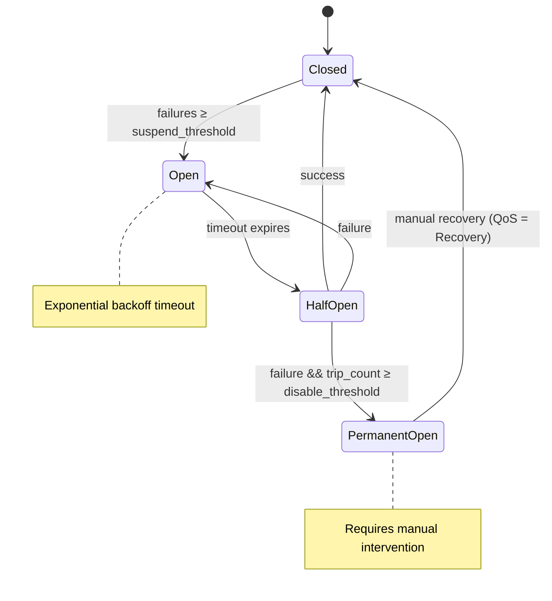

## Overview

The Fill Circuit Breaker is a fault tolerance mechanism designed to protect the RFQ (Request for Quote) system from unreliable market makers. It monitors the success/failure rates of swap transactions and automatically suspends or disables underperforming providers to maintain system stability.

## How It Works

The circuit breaker operates as a background job that:

1. **Monitors swap events** from the database to track market maker performance
2. **Maintains individual circuit breakers** for each market maker (webhook)
3. **Automatically suspends or disables** providers based on failure thresholds
4. **Implements exponential backoff** for recovery attempts
5. **Provides network-wide protection** against system-wide failures
6. **Sends notifications** when circuit breakers trip

## Architecture

### Core Components

#### 1. FillCircuitBreakerJob
The main job that orchestrates the circuit breaker functionality:
- Runs periodically (default: every 60 seconds)
- Fetches swap events from the database
- Updates circuit breaker states
- Manages provider QoS (Quality of Service) levels

#### 2. FillRateGuard
Central coordinator that manages multiple circuit breakers:
- Maintains a map of circuit breakers (one per webhook/provider)
- Tracks the last processed event ID for incremental processing
- Calculates network-wide circuit breaker statistics
- Provides thread-safe access to circuit breaker states

#### 3. CircuitBreaker
Individual circuit breaker for each market maker:
- Tracks failure counts and accumulated failures
- Manages state transitions
- Implements exponential backoff for timeouts
- Handles success/failure recording

#### 4. State Enum
Defines the four possible states of a circuit breaker:

```rust
enum State {
    Closed,           // Normal operation
    Open(Instant, Duration), // Suspended with timeout
    HalfOpen,         // Testing recovery
    PermanentOpen,    // Permanently disabled
}
```

## Circuit Breaker States

### State Diagram



### State Descriptions

#### Closed State
- **Condition**: Normal operation
- **Behavior**: All requests are allowed through
- **Transition**: Moves to Open when `failure_count ≥ suspend_threshold`

#### Open State
- **Condition**: Circuit is tripped due to failures
- **Behavior**: Provider is suspended (QoS set to "Suspended")
- **Timeout**: Uses exponential backoff: `base_timeout * 2^retries`
- **Transition**: Moves to HalfOpen when timeout expires

#### HalfOpen State
- **Condition**: Testing if the provider has recovered
- **Behavior**: Allows limited testing
- **Transition**: 
  - Success → Closed (provider recovers)
  - Failure → Open (with increased timeout)

#### PermanentOpen State
- **Condition**: Provider has failed too many times
- **Behavior**: Provider is permanently disabled (QoS set to "Offline")
- **Recovery**: Only through manual intervention (setting QoS to "Recovery")

## Configuration Parameters

### Core Thresholds

| Parameter | Environment Variable | Default | Description |
|-----------|---------------------|---------|-------------|
| `suspend_threshold` | `JOB_FILL_CIRCUIT_BREAKER_SUSPEND_THRESHOLD` | 5 | Failures needed to trip circuit |
| `disable_threshold` | `JOB_FILL_CIRCUIT_BREAKER_DISABLE_THRESHOLD` | 8 | Trips needed for permanent disable |
| `backoff_base_timeout` | `JOB_FILL_CIRCUIT_BREAKER_BACKOFF_BASE_TIMEOUT` | 300,000ms | Base timeout for exponential backoff |
| `backoff_max_timeout` | `JOB_FILL_CIRCUIT_BREAKER_BACKOFF_MAX_TIMEOUT` | 1,800,000ms | Maximum timeout cap |

### Job Settings

| Parameter | Environment Variable | Default | Description |
|-----------|---------------------|---------|-------------|
| `enabled` | `JOB_FILL_CIRCUIT_BREAKER_ENABLED` | false | Enable/disable the job |
| `interval` | `JOB_FILL_CIRCUIT_BREAKER_INTERVAL` | 60s | How often to run the job |
| `automatic_suspend` | `JOB_FILL_CIRCUIT_BREAKER_AUTOMATIC_SUSPEND` | false | Auto-suspend providers |

### Protection Settings

| Parameter | Environment Variable | Default | Description |
|-----------|---------------------|---------|-------------|
| `network_protection_threshold` | `JOB_FILL_CIRCUIT_BREAKER_NETWORK_PROTECTION_THRESHOLD` | 0.7 | Stop suspending if >70% are suspended |
| `maximum_permissible_user_delay` | `JOB_FILL_CIRCUIT_BREAKER_MAXIMUM_PERMISSIBLE_USER_DELAY` | 20s | Don't count failures if user was too slow |

## Event Processing

### Monitored Event Types

The circuit breaker analyzes swap events with these states:
- **Confirmed**: Successful swap (records success)
- **Dropped**: Failed swap due to provider issue (records failure)
- **Rejected**: Failed swap due to provider rejection (records failure)
- **Failed**: Failed swap due to error (records failure)

### Success/Failure Logic

```rust
match event_state {
    EventState::Confirmed => {
        // Calculate market maker delay
        let mm_delay = (included_at - resolved_at).num_seconds();
        record_success(webhook_id);
    }
    EventState::Dropped | EventState::Rejected 
        if user_delay < maximum_permissible_user_delay => {
        // Only count as failure if user wasn't too slow
        record_failure(webhook_id);
    }
    EventState::Failed => {
        // Always count system failures
        record_failure(webhook_id);
    }
    _ => {} // Ignore other states
}
```

### Failure Count Decay

To allow recovery over time, failure counts decay when recording successes:

```rust
fn decay_failure_count(failure_count: u32) -> u32 {
    (failure_count as f64 * 0.8).floor() as u32
}
```

## Exponential Backoff

When a circuit breaker trips, the timeout increases exponentially:

```
timeout = base_timeout * 2^retries (capped at max_timeout)
```

### Example Progression
- Base timeout: 5 minutes 
- Max timeout: 30 minutes 

| Retry | Timeout |
|-------|---------|
| 0 | 5 minutes |
| 1 | 10 minutes |
| 2 | 20 minutes |
| 3+ | 30 minutes (max) |

## Network Protection

The system includes protection against network-wide failures:

- **Threshold**: If >70% of providers are suspended simultaneously
- **Action**: Stop automatic suspensions and send alert
- **Rationale**: Likely indicates infrastructure issue, not individual provider problems

## Quality of Service (QoS) Management

The circuit breaker manages provider QoS levels:

| QoS Level | Description | Circuit State |
|-----------|-------------|---------------|
| `Prod` | Normal operation | Closed |
| `Suspended` | Temporarily disabled | Open |
| `Recovery` | Manual recovery mode | PermanentOpen → Closed |
| `Offline` | Permanently disabled | PermanentOpen |

## Notifications

### Notification Types

#### Suspension Notifications
```
🟡 **ProviderName** suspended until 14:30 UTC • Accumulated failures: 12 • Next retry in 20 minutes
```

#### Disable Notifications
```
🔴 **ProviderName** disabled (Offline) due to 25 accumulated failures
```

#### Recovery Notifications
```
🟢 **ProviderName** back to normal Prod
```

#### Network Protection Alerts
```
🚨 Network protection threshold (0.70) reached, 0.85 of makers are suspended
```

### Delivery Channels

- **Telegram**: Sent to provider-specific chat IDs
- **Discord**: Sent to configured webhook URL

## Conclusion

The Fill Circuit Breaker provides robust fault tolerance for the RFQ system by automatically managing underperforming providers. Its multi-state design with exponential backoff ensures graceful degradation and recovery while protecting against both individual provider failures and system-wide issues.