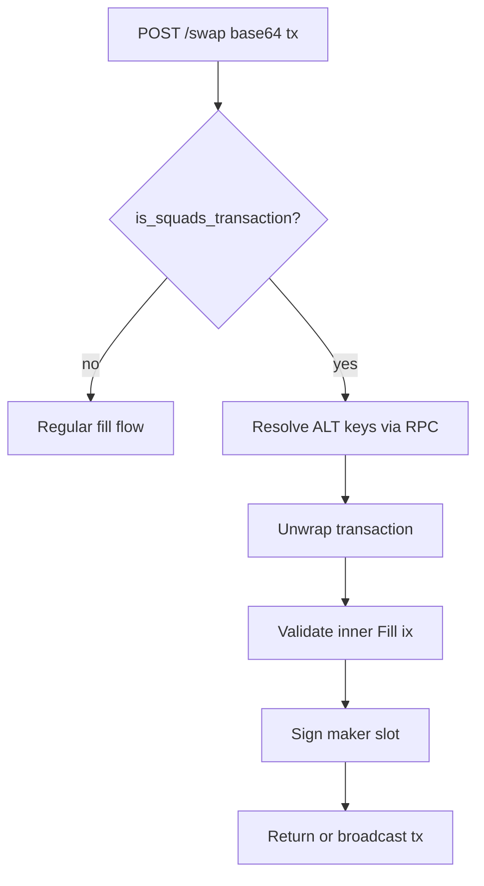

# Squads Multisig Support

When the taker is a [Squads V5](https://squads.so/) multisig, the RFQ API wraps the fill instructions into a single `executeTransactionSyncV2` CPI before delivering the transaction in `POST /swap`. This page covers the extra steps your webhook needs to handle that case.

The MM only ever signs the **maker** slot of the outer transaction. Member signatures are populated by the user's wallet before the tx reaches the MM.

## Flow Overview



## 1. Detect

Use the `squads-sdk` helper to check the instruction discriminator — no RPC required:

```rust
use squads_sdk::{is_squads_transaction, transaction::decode_transaction_base64};

let tx = decode_transaction_base64(&swap_req.transaction)?;
if is_squads_transaction(&tx) {
    // Squads-wrapped path
} else {
    // Regular fill validation
}
```

## 2. Resolve Address Lookup Tables

Wrapped transactions almost always use ALTs. Fetch each ALT account and resolve indexes to build the full account-key list:

```
account_keys = static_keys ++ ALT_writable_resolved ++ ALT_readonly_resolved
```

This order matches what `getTransaction` returns in `accountKeys`.

## 3. Unwrap

```rust
use squads_sdk::unwrap_transaction_with_account_keys;

let unwrapped = unwrap_transaction_with_account_keys(&tx, &account_keys)?;
// unwrapped.instructions   — original fill instructions
// unwrapped.settings_pda   — Squads settings PDA (the multisig)
// unwrapped.members        — required signers
```

:::warning
The `is_signer` and `is_writable` flags on recovered `AccountMeta`s are not faithful. Validate by **comparing pubkeys** against an expected layout — don't trust the flags.
:::

## 4. Validate the inner instructions

The on-chain validator can't be applied to the outer wrapped tx (its fee payer is a Squads member, not the maker). Run equivalent checks against `unwrapped.instructions`:

- Exactly one `order_engine::Fill` instruction.
- Inner `taker == settings_vault_pda` (re-derive via `derive_vault_pda(&settings_pda, vault_index)`).
- Inner `maker`, `input_mint`, `output_mint`, `input_amount`, `output_amount`, `expire_at` all match the quote.
- Receiver transfer and Lighthouse instructions follow the same rules as the non-wrapped flow.
- `compute_unit_limit` and `compute_unit_price` are within accepted range.

Optionally, fetch `settings_pda` and parse with `parse_squads_settings(&data)` to confirm the on-chain `threshold` and member set before signing.

## 5. Sign the maker slot

The maker is **not at index 0** — the wrap routine prepends multisig members to the signers section. Look up the maker by pubkey:

```rust
let maker_pos = tx.message
    .static_account_keys()
    .iter()
    .position(|k| k == &maker_keypair.pubkey())
    .ok_or("maker not in outer signers")?;

let signature = maker_keypair.sign_message(&tx.message.serialize());
tx.signatures[maker_pos] = signature;
```

:::danger
Do not write to `tx.signatures[0]` — for Squads-wrapped txs, slot 0 is a member's signature and overwriting it will break the message. The `server-example` template assumes the non-wrapped flow and must be adjusted here.
:::

## 6. Return or submit

Re-serialize the now fully-signed transaction and either:
- broadcast it via your RPC and return the signature in `SwapResponse.tx_signature`, or
- return it back to the RFQ API in the same response field.

Either path is identical to the non-wrapped flow.

## Error handling

Map `SquadsSdkError` variants to existing `RejectionReason`s:

| Error | Suggested handling |
|------|------|
| `UnrecognizedDiscriminator` | Shouldn't happen after detection — treat as malformed (`400`). |
| `InvalidBase64` / `InvalidTransaction` | Malformed (`400`). |
| `ParseError` (account index out of range) | Malformed or stale ALT — re-fetch ALTs once, then reject. |
| `InvalidSettingsData` | On-chain settings shape changed — reject and alert. |
| Inner-fill validation failure | Same `RejectionReason`s as the non-wrapped flow. |

## Out of scope

- **Fees**: the MM pays tx fees as today. The outer fee payer is currently `members[0]`.
- **CU sizing**: the RFQ API computes the outer CU limit from simulation.
- **Submitting through Squads directly**: not supported — the maker must sign the outer tx so its `is_signer` flag propagates through CPI to the inner Fill.
