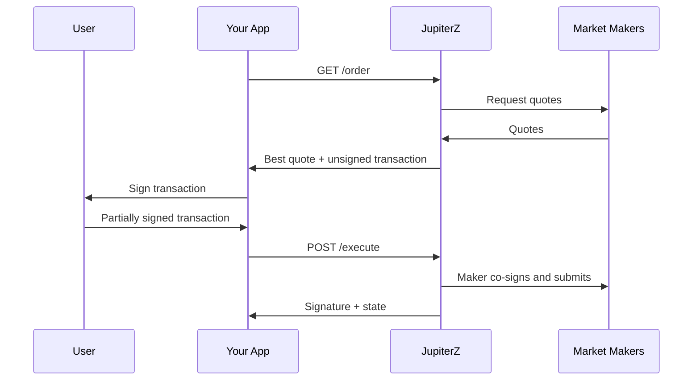

# JupiterZ for Integrators

The JupiterZ API lets you source RFQ liquidity directly: request a quote from Jupiter's market
makers, have the user sign the returned transaction, and send it back for execution.

Unlike the [Market Maker docs](../intro), this section is for **integrators consuming quotes** —
wallets, aggregators, trading UIs and bots.

:::info Access
JupiterZ is available as a standalone API through the
**[Jupiter Develop Platform](https://developers.jup.ag/)**. Create an account there to get an API
key.
:::

## Base URL

```
https://api.jup.ag/swap/v2/jupiterz
```

## Authentication

Every request must carry your API key:

```
x-api-key: your-api-key
```

Requests without it return `401 Unauthorized`.

## Endpoints

| Endpoint | Method | Purpose |
|----------|--------|---------|
| [`/order`](./order) | `GET` | Best quote for a single token pair |
| [`/global-order`](./order#global-order) | `GET` | Best quote across up to 5 candidate output mints |
| [`/execute`](./execute) | `POST` | Submit the signed transaction for execution |

## How it works



The transaction returned by `/order` is a **base64-encoded versioned transaction**. The taker signs
it (partial signature); the market maker adds the final signature and submits it on-chain. You never
build or submit the transaction yourself.

## Quickstart

```ts
import { VersionedTransaction } from '@solana/web3.js';

const BASE = 'https://api.jup.ag/swap/v2/jupiterz';
const headers = { 'x-api-key': process.env.JUP_API_KEY! };

// 1. Get a quote
const params = new URLSearchParams({
  inputMint: 'So11111111111111111111111111111111111111112',   // SOL
  outputMint: 'EPjFWdd5AufqSSqeM2qN1xzybapC8G4wEGGkZwyTDt1v', // USDC
  amount: '1000000000',                                        // 1 SOL
  taker: takerPublicKey.toBase58(),
  swapMode: 'ExactIn',
});

const order = await fetch(`${BASE}/order?${params}`, { headers }).then(r => r.json());

// 2. Sign it
const tx = VersionedTransaction.deserialize(
  Buffer.from(order.transaction, 'base64'),
);
tx.sign([takerKeypair]);

// 3. Execute
const result = await fetch(`${BASE}/execute`, {
  method: 'POST',
  headers: { ...headers, 'Content-Type': 'application/json' },
  body: JSON.stringify({
    requestId: order.requestId,
    quoteId: order.quoteId,
    transaction: Buffer.from(tx.serialize()).toString('base64'),
  }),
}).then(r => r.json());

console.log(result.state, result.signature);
```

## Amounts

All amounts are **strings in the token's smallest unit**, so no precision is lost:

```json
{
  "amount": "1000000",     // 1 USDC (6 decimals)
  "amount": "1000000000"   // 1 SOL (9 decimals)
}
```

## Errors

Errors use a consistent JSON body:

```json
{
  "error": "No quote found",
  "errorCode": "NO_QUOTE_FOUND"
}
```

`error` is always present. `errorCode` is `null` unless the failure maps to one of the codes below.

| Status | Meaning |
|--------|---------|
| `400 Bad Request` | Invalid or missing parameters, expired quote, failed simulation |
| `401 Unauthorized` | Missing or invalid `x-api-key` |
| `404 Not Found` | No market maker quoted this pair |
| `429 Too Many Requests` | Rate limit exceeded |
| `500 Internal Server Error` | Server-side failure |

### Error codes

| Code | Meaning |
|------|---------|
| `NO_QUOTE_FOUND` | No market maker returned a quote for this request |
| `QUOTE_EXPIRED` | The quote expired before `/execute` was called |
| `0x1` | Taker has insufficient funds |
| `0xbc4` | A required token account is missing |
| `0x11` | Token account is frozen |
| `SIMULATION_FAILED` | The swap could not be simulated |
| `TRANSACTION_ERROR` | Transaction-level failure during simulation |
| `INSTRUCTION_ERROR` | Instruction-level failure during simulation |

## Next steps

- **[Order Endpoints](./order)** — request a quote
- **[Execute Endpoint](./execute)** — execute a signed quote
