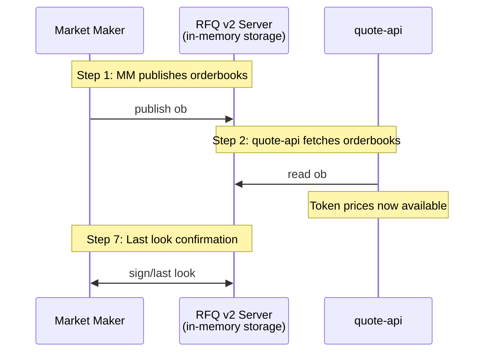
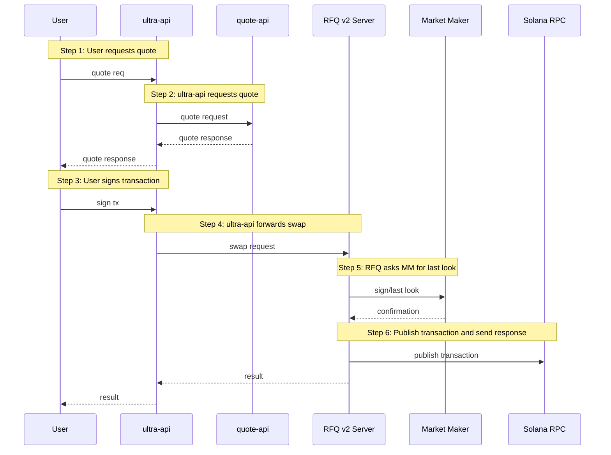

# RFQ v2 Architecture

Jupiter RFQ v2 is a high-performance Request for Quote system built on gRPC streaming for market makers to provide competitive liquidity on Solana.

## Documentation

- **[Overview](./v2/overview.md)**: Introduction to RFQ v2 features and capabilities
- **[Getting Started](./v2/getting-started.md)**: Setup guide and prerequisites for market makers
- **[SDK Integration](./v2/sdk-integration.md)**: Detailed examples for Rust and Python SDKs
- **[gRPC API Reference](./v2/grpc-api.md)**: Complete protocol specification

## Market Maker Flow

## User Flow

## Key Features

- **Bidirectional gRPC Streaming**: Real-time quote updates and swap notifications
- **Multi-level Orderbooks**: Submit bid/ask levels with custom pricing
- **Last Look**: Review and sign transactions before execution
- **Low Latency**: Direct streaming connection for minimal delays
- **Multi-language SDKs**: Official Rust and Python support

## Next Steps

Start with the [Overview](./v2/overview.md) to understand RFQ v2 capabilities, then follow the [Getting Started Guide](./v2/getting-started.md) to begin your integration.
