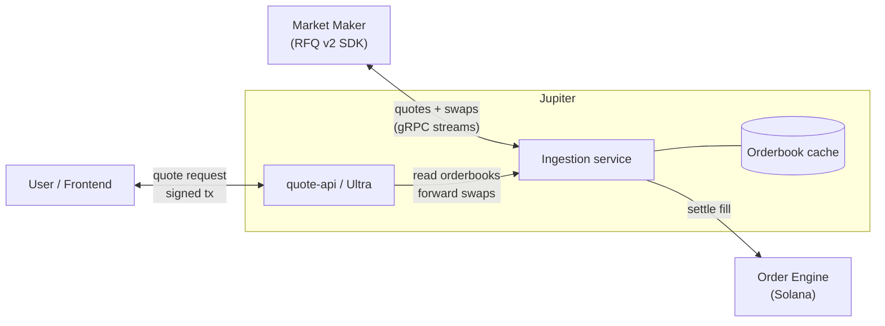
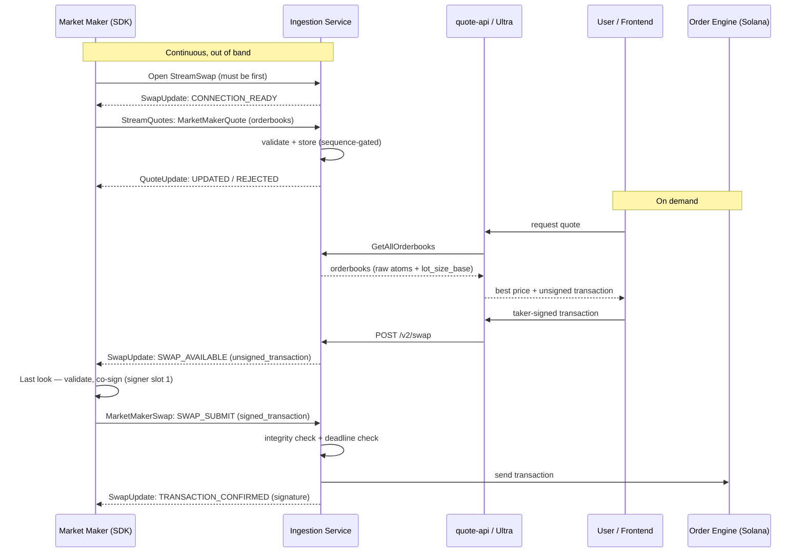

# JupiterZ v2

**JupiterZ v2** (internally, **RFQ v2**) is Jupiter's streaming Request-for-Quote system for market makers on Solana. Market makers connect over **gRPC**, continuously stream priced orderbooks, and settle user swaps on-chain through Jupiter's Order Engine program — reviewing and co-signing each fill (**last look**) before it lands.

This section is the integration reference for market makers. It is written against the shipped code in the [`rfq-v2-sdk`](https://github.com/jup-ag/rfq-v2-sdk) (Rust and Python SDKs) and the `market-maker-ingestion-service` that your SDK connects to.

:::info JupiterZ vs RFQ v2
"JupiterZ" is the product/consumer brand; "RFQ v2" is the technical name for the same system. This documentation uses **RFQ v2** when talking about the protocol and SDKs.
:::

## Two generations, side by side

V2 does not replace V1 — they run concurrently, and you can integrate with either or both.

| | V1 (webhook) | V2 (streaming) |
|---|---|---|
| Transport | HTTP webhooks (Jupiter calls you per request) | Persistent **bidirectional gRPC** streams (you push continuously) |
| Quoting | Cold start on every request; respond within a deadline | Quotes served from an **in-memory orderbook cache**; you set your own cadence |
| Quote ↔ swap | Same webhook for both | **Decoupled**: a quote stream and a separate swap stream |
| Pricing model | Compute per request | Stream multi-level orderbooks (bids/asks) ahead of time |
| Settlement | Order Engine program (on-chain) | **Same** Order Engine program (unchanged) |

The [V1 webhook documentation](./intro.md) covers the webhook flow. The rest of this section is V2 only.

## Documentation map

- **[Overview](./v2/overview.md)** — what RFQ v2 is, the streaming model, and what you need to integrate.
- **[Getting Started](./v2/getting-started.md)** — credentials, installing the Rust or Python SDK, and your first connection.
- **[SDK Integration](./v2/sdk-integration.md)** — the full quoting and swap loop with the official SDKs.
- **[Last Look & Maker Safety](./v2/last-look-and-safety.md)** — validating and co-signing fills, and the on-chain guards that protect your funds.
- **[gRPC API Reference](./v2/grpc-api.md)** — the protobuf contract, encoding rules, authentication, and server-side validation.
- **[Testing](./v2/testing.md)** — the SDK end-to-end suite, unit tests, and the pre-production checklist.

## Architecture

A market maker keeps two long-lived gRPC streams open to the ingestion service. Quotes flow into an in-memory orderbook cache that Jupiter's quote layer reads when a user asks for a price; when the user signs, the swap is pushed back to the market maker for last look.

*The two market-maker streams (quotes in, swaps out) run to the ingestion service, which caches orderbooks for Jupiter's quote layer and settles co-signed fills on-chain. The step-by-step ordering is in the [end-to-end flow](#end-to-end-flow) below.*

### End-to-end flow

:::warning The swap stream must be open before you quote
The ingestion service **rejects every quote** from a maker that does not have a live `StreamSwap` connection. Open your swap stream first, then start quoting. See [SDK Integration](./v2/sdk-integration.md#connect-both-streams).
:::

## Next steps

Start with the **[Overview](./v2/overview.md)** to understand the model, then follow **[Getting Started](./v2/getting-started.md)** to connect.
