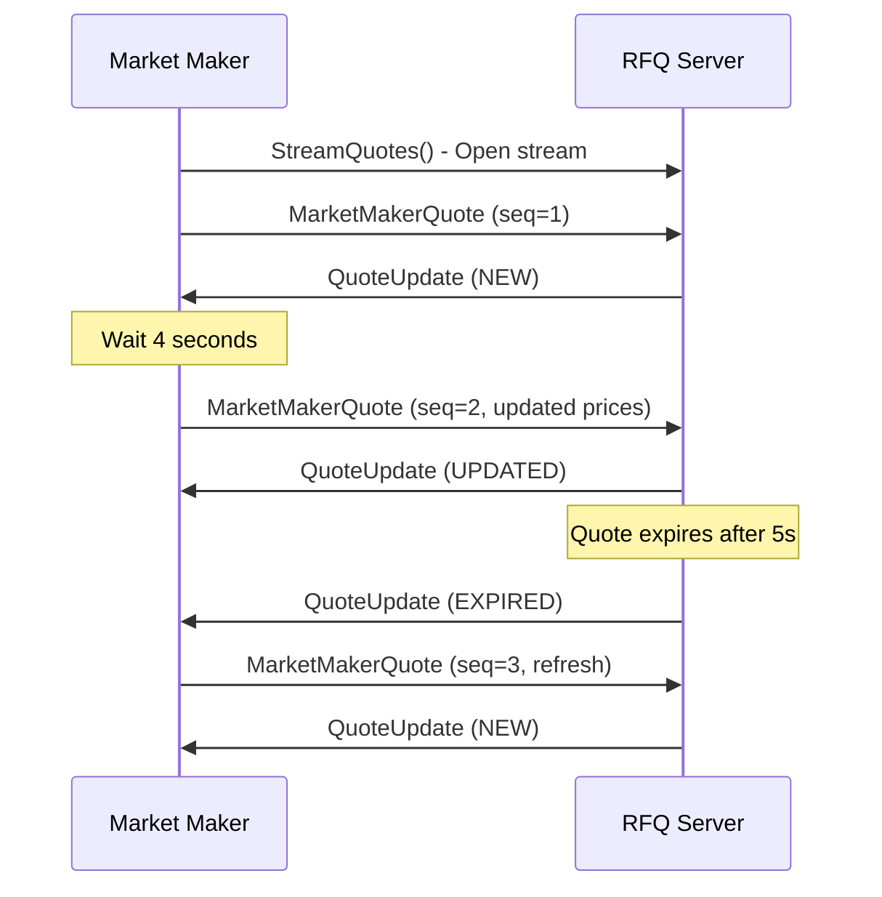
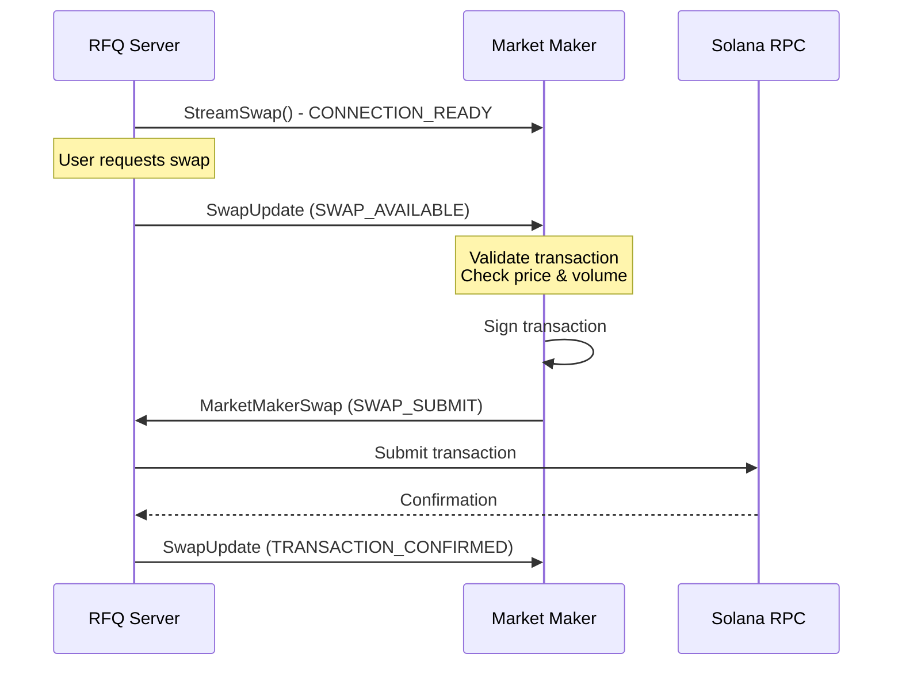

# gRPC API Reference

This document provides a complete reference for the Jupiter RFQ v2 gRPC protocol based on the `market_maker.proto` specification.

## Service Definition

```protobuf
service MarketMakerIngestionService {
    rpc GetLastSequenceNumber(SequenceNumberRequest) returns (SequenceNumberResponse);
    rpc GetAllOrderbooks(GetAllOrderbooksRequest) returns (GetAllOrderbooksResponse);
    rpc StreamQuotes(stream MarketMakerQuote) returns (stream QuoteUpdate);
    rpc StreamSwap(stream MarketMakerSwap) returns (stream SwapUpdate);
}
```

---

## RPC Methods

### GetLastSequenceNumber

Retrieves the last sequence number for a market maker. Use this to synchronize after reconnection.

**Request:**
```protobuf
message SequenceNumberRequest {
    required string maker_id = 1;
    required string auth_token = 2;
}
```

**Response:**
```protobuf
message SequenceNumberResponse {
    required bool success = 1;
    required uint64 last_sequence_number = 2;
    required string message = 3;
}
```

**Example:**
```rust
let response = client.get_last_sequence_number(
    maker_id,
    auth_token
).await?;

let next_sequence = response.last_sequence_number + 1;
```

---

### GetAllOrderbooks

Retrieves all active orderbooks across token pairs. Useful for monitoring market state.

**Request:**
```protobuf
message GetAllOrderbooksRequest {
    optional Cluster cluster = 1;  // Filter by cluster (optional)
}
```

**Response:**
```protobuf
message GetAllOrderbooksResponse {
    repeated Orderbook orderbooks = 1;
    required uint64 timestamp = 2;  // Snapshot timestamp
}
```

**Orderbook Structure:**
```protobuf
message Orderbook {
    required TokenPair token_pair = 1;
    repeated PriceLevel bid_levels = 2;  // Sorted highest first
    repeated PriceLevel ask_levels = 3;  // Sorted lowest first
    required uint64 last_updated = 4;
    required string maker_address = 5;
    required uint64 expiry_time = 6;
    required uint64 lot_size_base = 7;
}
```

---

### StreamQuotes

Bidirectional stream for submitting market maker quotes and receiving updates.

**Client → Server (MarketMakerQuote):**

```protobuf
message MarketMakerQuote {
    // Infrastructure fields
    required uint64 timestamp = 1;           // Unix timestamp (microseconds)
    required uint64 sequence_number = 2;     // Monotonic sequence per MM
    required uint64 quote_expiry_time = 3;   // Quote validity duration (microseconds)
    required string maker_id = 4;            // Market maker ID
    required string maker_address = 5;       // Solana address
    required uint64 lot_size_base = 6;       // Minimum trade size
    
    // Core fields
    required Cluster cluster = 7;            // MAINNET or DEVNET
    required TokenPair token_pair = 8;       // Token pair
    repeated PriceLevel bid_levels = 9;      // Bid prices
    repeated PriceLevel ask_levels = 10;     // Ask prices
}
```

**Server → Client (QuoteUpdate):**

```protobuf
message QuoteUpdate {
    required UpdateType update_type = 1;
}

enum UpdateType {
    UPDATE_TYPE_UNSPECIFIED = 0;
    UPDATE_TYPE_NEW = 1;       // Quote accepted
    UPDATE_TYPE_UPDATED = 2;   // Quote updated
    UPDATE_TYPE_EXPIRED = 3;   // Quote expired, resubmit
}
```

**Field Details:**

| Field | Type | Description |
|-------|------|-------------|
| `timestamp` | uint64 | Current Unix timestamp in microseconds |
| `sequence_number` | uint64 | Monotonically increasing counter (start from 1) |
| `quote_expiry_time` | uint64 | How long the quote is valid (microseconds, e.g., 5000000 = 5s) |
| `maker_id` | string | Your unique maker identifier |
| `maker_address` | string | Your Solana wallet address |
| `lot_size_base` | uint64 | Minimum trade size in base token units |
| `cluster` | Cluster | `CLUSTER_MAINNET` or `CLUSTER_DEVNET` |
| `token_pair` | TokenPair | Base and quote token definitions |
| `bid_levels` | PriceLevel[] | Buy orders (price descending) |
| `ask_levels` | PriceLevel[] | Sell orders (price ascending) |

---

### StreamSwap

Bidirectional stream for swap execution with last look.

**Server → Client (SwapUpdate):**

```protobuf
message SwapUpdate {
    required SwapMessageType message_type = 1;
    optional string swap_uuid = 2;                 // Present for SWAP_AVAILABLE, TRANSACTION_CONFIRMED
    optional string unsigned_transaction = 3;      // Present for SWAP_AVAILABLE (base58)
    optional string transaction_signature = 4;     // Present for TRANSACTION_CONFIRMED
    optional string status_message = 5;            // For CONNECTION_READY, ERROR
}

enum SwapMessageType {
    SWAP_MESSAGE_TYPE_PING = 0;
    SWAP_MESSAGE_TYPE_PONG = 1;
    SWAP_MESSAGE_TYPE_CONNECTION_READY = 2;
    SWAP_MESSAGE_TYPE_SWAP_AVAILABLE = 3;
    SWAP_MESSAGE_TYPE_SWAP_SUBMIT = 4;
    SWAP_MESSAGE_TYPE_TRANSACTION_CONFIRMED = 5;
    SWAP_MESSAGE_TYPE_ERROR = 6;
}
```

**Client → Server (MarketMakerSwap):**

```protobuf
message MarketMakerSwap {
    required SwapMessageType message_type = 1;
    required string swap_uuid = 2;
    required string signed_transaction = 3;  // Base58 encoded signed transaction
}
```

**Swap Flow:**

1. **CONNECTION_READY**: Server confirms connection
2. **SWAP_AVAILABLE**: Server sends unsigned transaction for market maker to sign
   - Contains: `swap_uuid`, `unsigned_transaction` (base58)
3. **SWAP_SUBMIT**: Market maker returns signed transaction
   - Set `message_type = SWAP_MESSAGE_TYPE_SWAP_SUBMIT`
   - Include `swap_uuid` and `signed_transaction`
4. **TRANSACTION_CONFIRMED**: Server confirms transaction submission
   - Contains: `swap_uuid`, `transaction_signature`
5. **ERROR**: Something went wrong
   - Contains: `status_message` with error details

**Health Checks:**
- Server sends **PING** periodically
- SDK should respond with **PONG**

---

## Message Types

### Token

```protobuf
message Token {
    required string address = 1;    // Solana token mint address
    required uint32 decimals = 2;   // Token decimals (e.g., 9 for SOL, 6 for USDC)
    required string symbol = 3;     // Token symbol (e.g., "SOL", "USDC")
    required string owner = 4;      // Token owner/authority (optional)
}
```

### TokenPair

```protobuf
message TokenPair {
    required Token base_token = 1;   // Token being traded
    required Token quote_token = 2;  // Token used for pricing
}
```

**Example**: SOL/USDC pair
- `base_token`: SOL (9 decimals)
- `quote_token`: USDC (6 decimals)
- Price represents USDC per SOL

### PriceLevel

```protobuf
message PriceLevel {
    required uint64 volume = 1;  // Volume in base token's smallest unit
    required uint64 price = 2;   // Price in quote token per base token unit
}
```

**Encoding:**

For a SOL/USDC pair:
- **Volume**: `10_000_000_000` = 10 SOL (10 × 10^9 lamports)
- **Price**: `100_500_000` = 100.5 USDC per SOL (100.5 × 10^6)

**Formula:**
```
price = (quote_amount / quote_decimals) / (base_amount / base_decimals)
price_encoded = price × 10^quote_decimals
```

### Cluster

```protobuf
enum Cluster {
    CLUSTER_UNSPECIFIED = 0;
    CLUSTER_MAINNET = 1;
    CLUSTER_DEVNET = 2;
}
```

Use `CLUSTER_DEVNET` for testing, `CLUSTER_MAINNET` for production.

---

## Authentication

All RPCs require authentication via JWT token.

**Methods:**

1. **In Request**: Include `auth_token` field in requests (e.g., `SequenceNumberRequest`)
2. **In Metadata**: Set gRPC metadata header:
   ```
   authorization: Bearer <your-jwt-token>
   ```

**Token Expiration:**

Monitor for authentication errors and refresh tokens as needed.

---

## Error Handling

### Quote Stream Errors

- **Invalid sequence**: Server detected sequence gap, resubmit from last known sequence
- **Expired quote**: Quote TTL exceeded, submit new quote
- **Invalid token pair**: Token addresses not recognized
- **Invalid price**: Price levels malformed or out of bounds

### Swap Stream Errors

- **Signature mismatch**: Signed transaction doesn't match unsigned transaction
- **Insufficient balance**: Market maker wallet lacks funds
- **Transaction timeout**: Took too long to sign and submit
- **Invalid last look**: Swap conditions changed since quote

**Best Practice:** Log all errors and implement retry logic with exponential backoff.

---

## Rate Limits

While not enforced in the protocol, consider:

- **Quote updates**: Avoid exceeding 1 update per second per token pair
- **Reconnections**: Implement exponential backoff (1s, 2s, 4s, 8s, max 60s)
- **Concurrent streams**: Limit to avoid overwhelming your infrastructure

---

## Example Workflows

### Complete Quote Lifecycle



### Swap with Last Look



---

## Data Types Reference

### Timestamp Format

All timestamps are Unix timestamps in **microseconds**:

```python
import time
timestamp = int(time.time() * 1_000_000)
```

```rust
use std::time::{SystemTime, UNIX_EPOCH};
let timestamp = SystemTime::now()
    .duration_since(UNIX_EPOCH)
    .unwrap()
    .as_micros() as u64;
```

### Transaction Encoding

Transactions are base58 encoded:

**Python:**
```python
import base58
signed_tx_bytes = bytes(transaction)
signed_tx_base58 = base58.b58encode(signed_tx_bytes).decode()
```

**Rust:**
```rust
use bs58;
let signed_tx_base58 = bs58::encode(transaction.serialize()).into_string();
```

---

## Next Steps

- **[Getting Started](./getting-started.md)**: Set up your environment
- **[SDK Integration](./sdk-integration.md)**: Code examples and patterns
- **[Architecture](../v2.md)**: System overview and data flows

## Support

For protocol questions or issues:
- GitHub: [rfq-v2-sdk](https://github.com/jup-ag/rfq-v2-sdk)
- Discord: Jupiter community channels
