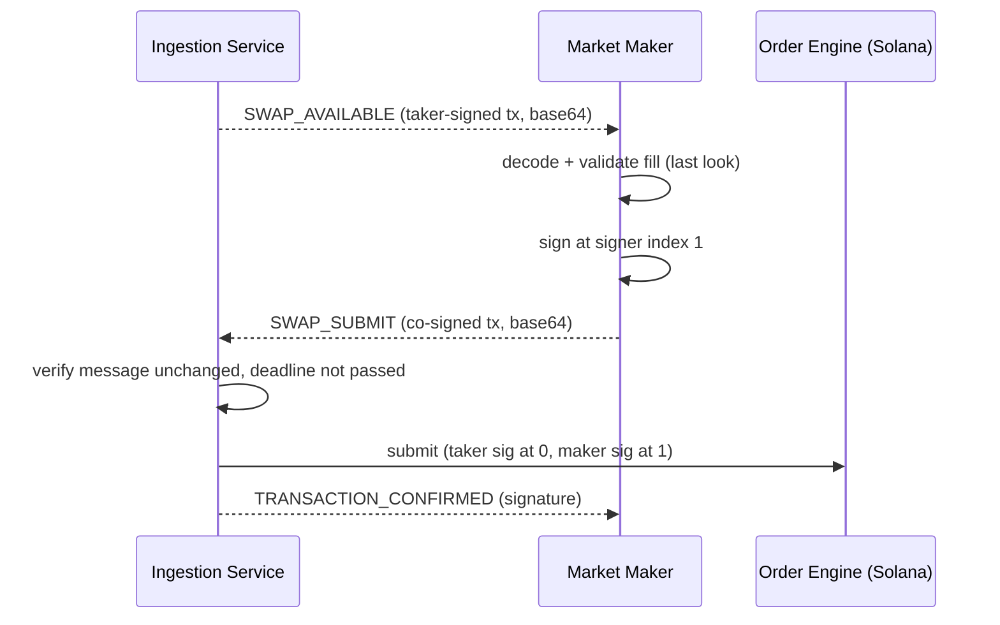

# Last Look & Maker Safety

When a user swaps against your quote, the ingestion service pushes the transaction to you **before** it settles. This is **last look**: your chance to verify the fill matches the price and size you quoted, confirm nothing malicious is attached, and only then co-sign. This page covers how to sign correctly and the guards — both in the SDK and on-chain — that protect your funds.

## What you receive

On `SWAP_AVAILABLE` you get a `swap_uuid` and an `unsigned_transaction` (base64). Despite the field name, the transaction is **already signed by the taker** at signer index 0. It contains a single Order Engine `fill_exact_in` instruction that spends the taker's input and pays out from your token accounts.

You are the **second required signer** — the *fill authority*. Your job is to:

1. Decode and inspect the transaction.
2. Confirm the embedded fill matches what you quoted.
3. Confirm your accounts appear **only** inside the fill instruction.
4. Add your signature at **signer index 1** and return the transaction as `SWAP_SUBMIT`.



:::danger Do not modify the transaction — only add your signature
Before submitting, the server compares the message of the transaction you return against the one it sent. If the **message bytes differ in any way**, the swap is rejected *and your account is forced `offline` immediately* (bypassing the normal circuit breaker). Add your signature and change nothing else. If you don't want to fill, simply don't respond — the swap will expire.
:::

## The deadline

You have a limited window to submit after `SWAP_AVAILABLE` — by default **10 seconds** (the server's `circuit_breaker_swap_timeout_secs`). Miss it and the swap expires; there is no fallback to a next-best quote in V2. Repeated no-shows or late responses count against you if the [circuit breaker](./lifecycle-and-circuit-breaker.md) is enabled.

## Co-signing the transaction

Decode the base64 transaction, deserialize it as a `VersionedTransaction`, sign the serialized message, and place your signature at **index 1** (index 0 belongs to the taker). Re-serialize to base64. Both legacy and V0 transactions are supported.

**Rust**

```rust
use base64::prelude::*;
use solana_sdk::{signature::Signer, transaction::VersionedTransaction};

fn co_sign(unsigned_tx_base64: &str, keypair: &solana_sdk::signature::Keypair)
    -> Result<String, Box<dyn std::error::Error + Send + Sync>>
{
    let tx_bytes = BASE64_STANDARD.decode(unsigned_tx_base64)?;
    let mut tx: VersionedTransaction = bincode::deserialize(&tx_bytes)?;

    // --- last look: validate `tx` against your quote here (see below) ---

    let message_data = tx.message.serialize();
    let signature = keypair.sign_message(&message_data);
    tx.signatures[1] = signature; // maker = second required signer (fill authority)

    Ok(BASE64_STANDARD.encode(bincode::serialize(&tx)?))
}
```

**Python**

```python
import base64
from solders.transaction import VersionedTransaction

def co_sign(unsigned_tx_base64: str, keypair) -> str:
    tx_bytes = base64.b64decode(unsigned_tx_base64)
    tx = VersionedTransaction.from_bytes(tx_bytes)

    # --- last look: validate `tx` against your quote here (see below) ---

    # solders signs at index 0; move the signature into the maker slot (index 1).
    signed = VersionedTransaction(tx.message, [keypair])
    sigs = list(tx.signatures)
    sigs[1] = list(signed.signatures)[0]
    final_tx = VersionedTransaction.populate(tx.message, sigs)
    return base64.b64encode(bytes(final_tx)).decode("ascii")
```

At minimum, reject transactions with no instructions or no account keys before signing. A production maker should go further and decode the fill (next section).

## Validating the fill (Rust `fill-decoder`)

The Rust SDK ships a companion crate, **`fill-decoder`**, for decoding the on-chain fill so you can check it against your quote during last look. It handles both a direct `fill_exact_in` instruction and one embedded inside a Jupiter aggregator route.

```rust
use fill_decoder::{check_fill_exclusivity, decode_transaction_base64, RFQ_V2_PROGRAM_ID};

let decoded = decode_transaction_base64(unsigned_tx_base64)?;
// Inspect the embedded fill: taker_side, amount_in_atoms, tick_size_qpb,
// lot_size_base, and the levels (px_ticks, qty_lots). Confirm the side, size,
// and effective price are consistent with the quote you streamed.

// Exclusivity: your accounts must appear ONLY in the fill instruction.
for maker_key in [maker_fill_authority, maker_base_token_account, maker_quote_token_account] {
    let report = check_fill_exclusivity(&decoded.message, maker_key);
    assert!(report.is_exclusive(), "maker key used outside the fill instruction");
}
```

:::note Python has no fill decoder
The `fill-decoder` crate is Rust-only. In Python, decode the transaction with `solders` and inspect the instructions yourself, or run your fill-validation logic in a Rust sidecar. The Python SDK still lets you receive, co-sign, and submit swaps — it just doesn't bundle fill decoding.
:::

### On-chain fill encoding vs. gRPC quote encoding

The values in the on-chain fill are **not** the same units as your gRPC quote. Your quote uses raw `price` (quote atoms per whole base token) and `volume` (base atoms). The on-chain `fill_exact_in` uses a discretised form:

- `qty_lots * lot_size_base` = base atoms
- `px_ticks * tick_size_qpb` = quote atoms per lot

`lot_size_base` is the bridge you set in your quote; `tick_size_qpb` is derived server-side and has no field in the gRPC message. Account for this when comparing a decoded fill to your quoted price.

## On-chain guards

Even if you sign, the Order Engine program (`fill_exact_in`) enforces protections on-chain, so a maliciously constructed transaction cannot drain your accounts:

- **Your signature is required over the exact bytes.** `fill_authority` (your key) is a required signer of `fill_exact_in`. A taker can write any `levels`/amounts into the instruction, but without your signature over those exact bytes the transaction never lands — which is why you must actually validate before signing.
- **`MakerAppearsInOtherInstruction` (error `6005`).** The program reads the instructions sysvar and **rejects the fill if your authority or token accounts appear in any other instruction** in the transaction. This defeats the "wrap the fill in a route and staple a token transfer that drains the maker" attack. `fill_decoder::check_fill_exclusivity` is the off-chain mirror of this check, so you can reject such a transaction before you even sign.

Other `fill_exact_in` errors you may observe: `6000 Overflow`, `6001 NoFill`, `6002 StaleOrderbook`, `6003 InvalidLevelOrdering`, `6004 InvalidCaller`.

The on-chain program is `rfq_v2` (program id `fd3nMFYTQjX1yr5ER8u7tPdHJB7qt8RpDpNtLQX2Br5`), with the single instruction `fill_exact_in`. Its accounts, in order, are: `user` (signer, writable), `fill_authority` (signer — your key), `user_base_token_account`, `user_quote_token_account`, `maker_base_token_account`, `maker_quote_token_account`, `base_mint`, `quote_mint`, `base_token_program`, `quote_token_program`, and the instructions sysvar.

## The `maker_safety` example

`examples/maker_safety.rs` (Rust) is a self-contained, offline demonstration of the attack and the defense. It builds two transactions against a test maker:

- an **honest** route where your accounts appear only inside the fill, and
- a **malicious** route that adds a bare SPL-token transfer draining your base account, authorised by your own fill authority.

It then runs `check_fill_exclusivity` over both and asserts the honest one passes while the malicious one is flagged — the same logic you should run during last look.

```bash
cargo run --example maker_safety
```

It needs no credentials or network. The companion `malicious_order_e2e.rs` test proves the on-chain program actually rejects a tampered fill — see [Testing](./testing.md#maker-safety-tests).

## Last-look checklist

Before you sign, confirm:

- [ ] The transaction decodes and has instructions and account keys.
- [ ] It contains an RFQ v2 `fill_exact_in` (directly or embedded in a route).
- [ ] The `taker_side`, size, and effective price match a level you currently quote.
- [ ] Your fill authority and token accounts appear **only** in the fill instruction (exclusivity).
- [ ] You have enough inventory to settle.
- [ ] You add your signature at **index 1** and change nothing else.
- [ ] You submit within the deadline (~10s).

## Next steps

- **[gRPC API Reference](./grpc-api.md)** — the message and encoding details.
- **[Testing](./testing.md)** — run the maker-safety and end-to-end tests.
