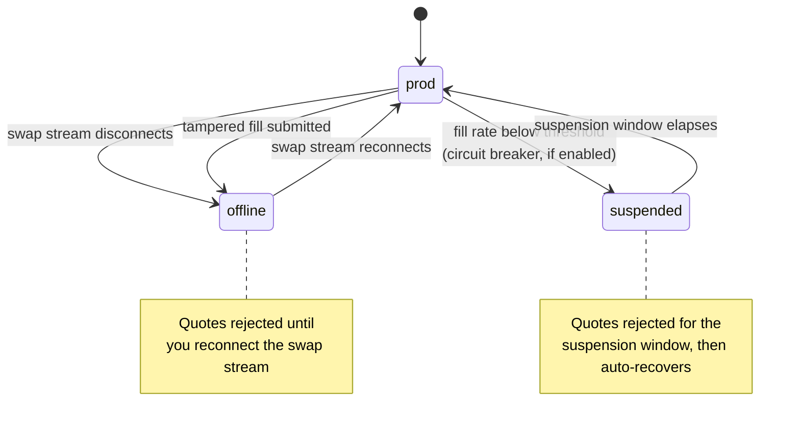

# Maker Lifecycle & Circuit Breaker

Your maker account has a **status** (QoS) that governs whether the ingestion service accepts your quotes and routes swaps to you. Certain events **bench** you — your quotes start getting rejected and you stop receiving swaps — until you recover. Understanding these transitions is the difference between "my quotes suddenly stopped being accepted" being a mystery or a one-line fix.

:::info This is the V2 model
This page describes RFQ **v2** (streaming). It is different from the [V1 circuit breaker](../circuit_breaker.md), which is webhook-based with a different state machine and configuration. Don't apply V1's parameters or states to V2.
:::

## Status states

| Status | Meaning | Quotes accepted? | Receives swaps? |
|---|---|---|---|
| `prod` | Healthy, normal operation | Yes | Yes |
| `offline` | Benched — no live swap stream (or forced off after tampering) | No | No |
| `suspended` | Benched by the fill-rate circuit breaker | No | No (excluded from orderbooks) |

(The underlying enum also defines `test` and `recovery`, but the V2 ingestion service does not use them — only `prod`, `offline`, and `suspended` occur in practice.)

While you are `offline` or `suspended`, the effects are:

- **Quotes** are rejected with `UPDATE_TYPE_REJECTED`. The `status_message` tells you which case you're in (see [Why you get benched](#why-you-get-benched)).
- **Swaps** are not routed to you, and `POST /v2/swap` targeting you fails (`503` when suspended, `500` when non-`prod`).
- **Orderbooks:** a `suspended` maker's books are excluded from `GetAllOrderbooks`, so Jupiter's quote layer won't price against you.

## State transitions

## Why you get benched

There are three ways to lose `prod` status. In practice today, **the first is by far the most common** — the fill-rate circuit breaker is disabled by default.

### 1. Your swap stream disconnected → `offline`

When your **last** `StreamSwap` connection drops, the server flips you from `prod` to `offline`. Because [quotes require a live swap stream](./grpc-api.md#server-side-validation), your quotes are then rejected with:

> `Rejected: swap streaming is offline. Connect your swap stream to resume quoting.`

or, if the status has already been written:

> `Market maker is not available (status: offline)`

**Recovery is automatic:** reconnect your swap stream and the server restores you to `prod` (it does this on the next `StreamSwap` connection, which is also why you should [open the swap stream before quoting](./sdk-integration.md#connect-both-streams)). This is why robust [reconnection with backoff](./sdk-integration.md#reconnection) matters — a dropped swap stream silently stops all your quoting until you reconnect.

### 2. You tampered with a fill → `offline`

If you return a `SWAP_SUBMIT` whose transaction **message** differs from the one the server sent (anything beyond adding your signature), the server rejects the swap and forces you `offline` **immediately** — this bypasses the fill-rate breaker entirely. See [Last Look & Maker Safety](./last-look-and-safety.md#co-signing-the-transaction): add your signature at signer index 1 and change nothing else. Recover the same way as case 1, by reconnecting your swap stream.

### 3. Your fill rate dropped → `suspended` (circuit breaker)

The **fill-rate circuit breaker** benches makers who repeatedly win quotes but don't complete the fill. It is **disabled by default**; when an operator enables it, it works as follows.

Over a rolling window it tracks, per maker:

- **Unfilled** — you did **not** respond to a `SWAP_AVAILABLE` within the deadline (the swap expired), or you responded **after** the deadline.
- **Filled** — the fill confirmed on-chain.

Crucially, **on-chain failures that aren't your fault do not count against you** — stale prices, insufficient taker balance, slippage, and RPC/confirmation errors are excluded. Only no-response and late-response feed the breaker.

If, within the window, you have at least `min_swaps` outcomes **and** your fill rate falls **below** `threshold_pct`, you are set `suspended` for the suspension window and rejected with:

> `Suspended: fill rate below threshold. Quotes rejected during suspension period.`

**Recovery is automatic:** when the suspension window elapses, you return to `prod` (checked on your next quote or swap).

#### Circuit-breaker settings

These are **server-side** settings configured by the Jupiter operator, not by you — listed here so you understand the behavior. Defaults:

| Setting | Env var | Default | Meaning |
|---|---|---|---|
| Enabled | `CIRCUIT_BREAKER_ENABLED` | `false` | Whether the fill-rate breaker runs at all |
| Window | `CIRCUIT_BREAKER_WINDOW_SECS` | `3600` | Rolling window (seconds) for fill-rate stats |
| Min swaps | `CIRCUIT_BREAKER_MIN_SWAPS` | `10` | Minimum outcomes in the window before evaluating |
| Threshold | `CIRCUIT_BREAKER_THRESHOLD_PCT` | `50` | Suspend if fill rate is below this percent |
| Suspension | `CIRCUIT_BREAKER_SUSPENSION_SECS` | `600` | How long a suspension lasts (seconds) |
| Last-look timeout | `CIRCUIT_BREAKER_SWAP_TIMEOUT_SECS` | `10` | Deadline to submit a fill (see below) |

## The last-look deadline is always enforced

`CIRCUIT_BREAKER_SWAP_TIMEOUT_SECS` (default **10 seconds**) is the window you have to return `SWAP_SUBMIT` after `SWAP_AVAILABLE`. This deadline is enforced **regardless of whether the fill-rate breaker is enabled**:

- Miss it and the swap **expires** — the fill is lost (there is no next-best-quote fallback in V2).
- If the breaker is enabled, that miss (or a late response) also counts as an **unfilled** outcome toward suspension.

So responding promptly matters even when the breaker is off.

## Staying healthy

To keep `prod` status and a good fill rate:

- **Keep your swap stream connected** and answer pings; reconnect immediately with backoff if it drops (a dropped swap stream is the number-one reason quotes stop being accepted).
- **Respond to `SWAP_AVAILABLE` within the deadline** (~10s). Keep last-look validation fast; don't stall.
- **Only sign quotes you can actually fill** — hold sufficient inventory (ATAs) and don't quote sizes you can't settle.
- **Never modify the transaction** beyond adding your signature (see [Last Look & Maker Safety](./last-look-and-safety.md)).
- **Quote realistic prices** — winning a quote and then letting it expire is exactly what the breaker penalizes.

## Next steps

- **[SDK Integration](./sdk-integration.md#reconnection)** — implement reconnection so a dropped stream doesn't leave you `offline`.
- **[Last Look & Maker Safety](./last-look-and-safety.md)** — respond to swaps correctly and on time.
- **[gRPC API Reference](./grpc-api.md#server-side-validation)** — the full list of quote rejection reasons.
