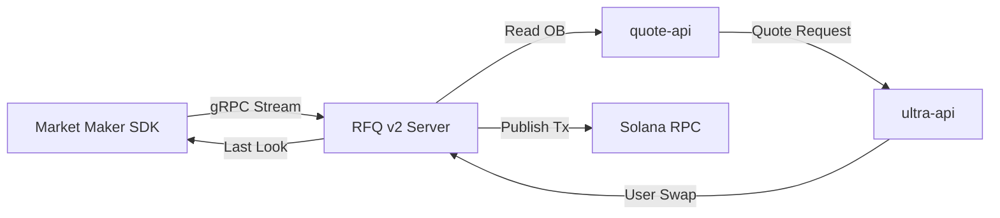

# JupiterZ v2 Overview

JupiterZ v2 is a next-generation Request for Quote system designed for market makers to provide competitive liquidity on Solana. Built on gRPC bidirectional streaming, it enables real-time quote submission and swap execution with low latency and high throughput.

## Key Features

### For Market Makers

- **Real-time Streaming**: Bidirectional gRPC streams for instant quote updates and swap notifications
- **Custom Pricing**: Submit multi-level orderbooks with bid/ask spreads tailored to your strategy
- **Last Look**: Review and sign transactions before execution
- **Low Latency**: Direct streaming connection reduces quote-to-execution time
- **Production Ready**: Built-in TLS, authentication, and health monitoring

### Technical Capabilities

- **Multi-language SDKs**: Official support for Rust and Python
- **Type-safe APIs**: Strongly typed protobuf messages ensure data integrity
- **Async/Await**: Native async support in both SDKs for efficient resource usage
- **Sequence Management**: Built-in synchronization with monotonic sequence numbers
- **Token Pair Support**: Handle multiple token pairs simultaneously

## How It Works

RFQ v2 operates through two main streaming channels:

### 1. Quote Stream

Market makers publish orderbooks with multiple price levels:

```
MM → RFQ Server: Submit orderbook (bids/asks with volume/price)
RFQ Server → MM: Acknowledgment (quote accepted/updated/expired)
```

### 2. Swap Stream

When a user requests a swap, the RFQ server notifies the market maker:

```
RFQ Server → MM: Swap available (unsigned transaction)
MM → RFQ Server: Signed transaction (after last look)
RFQ Server → MM: Transaction confirmed
```

## Architecture



## Getting Started

Market makers need:

1. **Credentials**: `MAKER_ID` and `AUTH_TOKEN` from Jupiter
2. **SDK**: Choose between Rust or Python based on your stack
3. **Solana Key**: Private key for transaction signing
4. **Pricing Logic**: Your market making strategy

See the [Getting Started Guide](./getting-started.md) for detailed setup instructions.

## What's Different from V1?

| Feature | V1 (Webhook) | V2 (gRPC Streaming) |
|---------|--------------|---------------------|
| Communication | HTTP webhooks | Bidirectional gRPC streams |
| Latency | Higher (request/response) | Lower (persistent connection) |
| Quote Updates | On-demand | Real-time streaming |
| Complexity | Higher (webhook infrastructure) | Lower (SDK handles streaming) |
| Scalability | Limited by HTTP | High throughput streams |

## Next Steps

- **[Getting Started](./getting-started.md)**: Set up your environment and credentials
- **[SDK Integration](./sdk-integration.md)**: Integrate Rust or Python SDK
- **[gRPC API Reference](./grpc-api.md)**: Detailed protocol documentation
