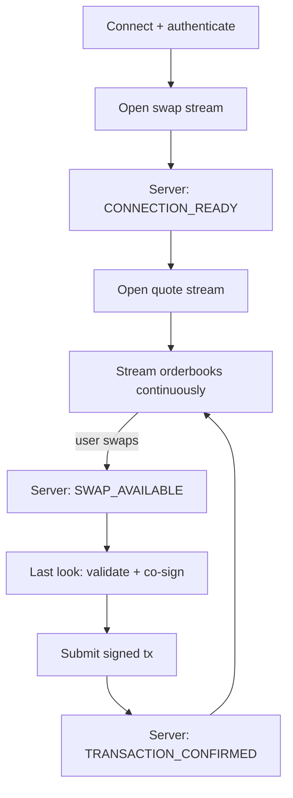

# Overview

RFQ v2 lets market makers provide competitive, on-chain liquidity on Solana through **persistent gRPC streams** instead of per-request webhooks. You push priced orderbooks continuously; Jupiter serves them from an in-memory cache; and when a user swaps against your price, you get a last-look opportunity to review and co-sign the transaction before it settles.

## The streaming model

You maintain **two long-lived, bidirectional gRPC streams** to the ingestion service:

- **Quote stream (`StreamQuotes`)** — you send `MarketMakerQuote` messages (multi-level bid/ask orderbooks for a token pair); the server replies with `QuoteUpdate` acknowledgements.
- **Swap stream (`StreamSwap`)** — the server pushes `SwapUpdate` messages when a user wants to trade against you; you reply with a co-signed transaction.

The two streams are decoupled, but not independent: **the swap stream must be connected for your quotes to be accepted.** A maker that is streaming quotes but not reachable for swaps would produce prices nobody can fill, so the server rejects those quotes.

## Key characteristics

- **Multi-level orderbooks** — quote several bid and ask price levels per token pair, at different sizes. The server keeps the **top 5 levels per side**.
- **Custom cadence** — there is no fixed response deadline for quoting. You reprice and resend on your own schedule; each quote carries an expiry so stale prices drop out automatically.
- **Last look** — every swap is pushed to you *before* it settles. You validate the fill against your quote and only then co-sign. If you don't respond in time, the swap simply expires.
- **On-chain settlement** — fills settle through Jupiter's Order Engine program on Solana. There is no custody or counterparty risk beyond the chain.
- **Sequence-numbered** — each quote carries a strictly increasing sequence number per maker, so the server can reject stale or out-of-order updates.
- **Type-safe SDKs** — official Rust and Python SDKs mirror each other for the core quote/swap/co-sign loop (same shape and naming) and generate strongly typed messages from the shared `market_maker.proto`. One difference: fill decoding (the `fill-decoder` crate) is Rust-only — see [Last Look & Maker Safety](./last-look-and-safety.md).

## What you need to integrate

1. **Credentials from Jupiter** — an **API key**, a maker id, and a gRPC endpoint. Onboarding is currently handled by the Jupiter team (there is no self-serve signup yet).
2. **A Solana keypair** — used to co-sign fills. Its public key is your **maker address**, and it must hold inventory (associated token accounts) for the tokens you quote.
3. **A pricing source** — your market-making logic. The example integrations pull reference prices from Jupiter's [DatAPI](https://datapi.jup.ag), but you can use any source.
4. **One of the SDKs** — Rust or Python. Both are supported and equivalent for the core quoting and swap flow (fill decoding is Rust-only).

:::info Cluster support
RFQ v2 settles on **Solana mainnet**. The protocol carries a `cluster` field for forward compatibility, but mainnet is the supported environment; do not assume devnet/testnet support.
:::

## How a trade happens

1. You stream orderbooks for one or more token pairs. Jupiter caches them.
2. A user requests a quote through Jupiter. The quote layer reads the cached orderbooks, picks the best price, and builds an unsigned Order Engine transaction.
3. The user signs and submits. Jupiter forwards the swap to you over your swap stream as `SWAP_AVAILABLE`, carrying the (taker-signed) transaction.
4. You perform **last look**: decode the transaction, confirm the embedded fill matches the price and size you quoted, and confirm no other instruction touches your accounts. If it checks out, you co-sign and return it as `SWAP_SUBMIT`.
5. The server verifies you didn't alter the transaction, submits it to Solana, and notifies you with `TRANSACTION_CONFIRMED` once it lands.

See **[Last Look & Maker Safety](./last-look-and-safety.md)** for the details of step 4 — including the on-chain guards that protect you from maliciously constructed transactions.

## What's different from V1

| Feature | V1 (webhook) | V2 (gRPC streaming) |
|---|---|---|
| Communication | HTTP webhooks | Bidirectional gRPC streams |
| Quote timing | Cold start, per request, on a deadline | Continuous push, your own cadence |
| Quote source at request time | Live call to your webhook | In-memory cache read (no round-trip to you) |
| Quote vs. swap | Same interface | Separate quote and swap streams |
| Authentication | Webhook registration | API key over gRPC metadata |
| Settlement | Order Engine program | Order Engine program (unchanged) |

## Next steps

- **[Getting Started](./getting-started.md)** — credentials, SDK install, and your first connection.
- **[SDK Integration](./sdk-integration.md)** — the full quoting and swap loop.
- **[gRPC API Reference](./grpc-api.md)** — the protocol, encoding, and validation rules.
