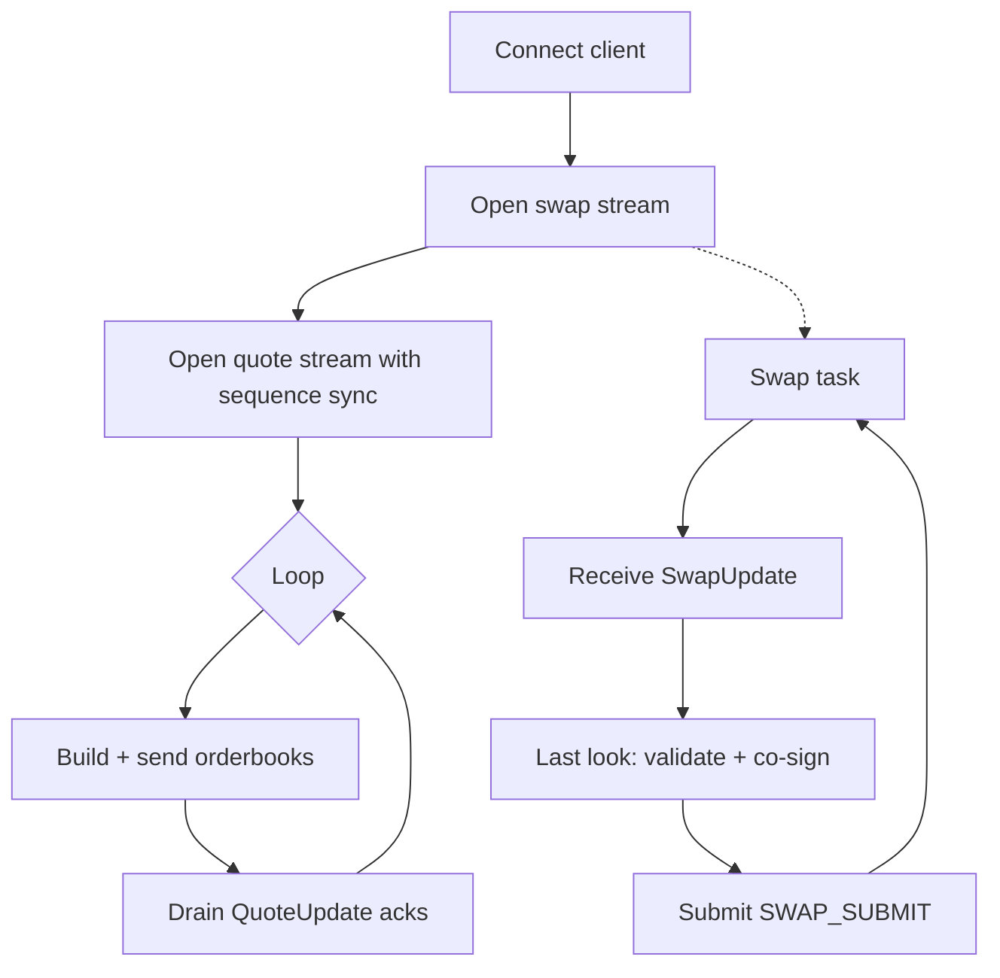

# SDK Integration

This guide walks through a complete market-maker integration with the official Rust and Python SDKs: connecting, streaming quotes, and handling swaps with last look. Both SDKs mirror each other, so the structure is identical in either language.

The runnable reference for everything here is `examples/production_streaming.rs` / `examples/production_streaming.py`. When in doubt, read the example.

## The shape of an integration



Two concurrent activities run for the life of the connection:

- a **quote loop** that repeatedly builds and sends orderbooks, and
- a **swap task** that reacts to incoming swap notifications.

## Connecting

Create a `ClientConfig` with your endpoint and API key, then connect. TLS is enabled automatically for `https://` endpoints (plain `http://` connects in cleartext — use it only for local testing).

**Rust**

```rust
use market_maker_client_sdk::{ClientConfig, MarketMakerClient, StreamConfig};
use std::time::Duration;

// Required once before opening a TLS connection.
let _ = rustls::crypto::aws_lc_rs::default_provider().install_default();

let config = ClientConfig::new("https://rfq-mm-edge-grpc.raccoons.dev")
    .with_timeout(30)
    .with_max_retries(5)
    .with_auth_token(std::env::var("MM_AUTH_TOKEN")?);

let mut client = MarketMakerClient::connect_with_config(config).await?;
```

**Python**

```python
from rfq_sdk import ClientConfig, MarketMakerClient, StreamConfig

config = (
    ClientConfig(endpoint="https://rfq-mm-edge-grpc.raccoons.dev")
    .with_timeout(30)
    .with_max_retries(5)
    .with_auth_token(os.environ["MM_AUTH_TOKEN"])
)

client = await MarketMakerClient.connect_with_config(config)
```

The API key you set with `with_auth_token` is sent as gRPC metadata on the streaming RPCs. It is an **API key, not a JWT** — do not add a `Bearer` prefix. See [Authentication](./grpc-api.md#authentication).

:::note StreamConfig is mostly advisory today
`StreamConfig` (buffer size, timeouts, `auto_reconnect`) is accepted by the streaming methods, but most fields are not yet wired into the SDK's transport — notably **there is no automatic reconnection**. `receive_update_timeout` takes an explicit timeout argument (a `Duration` in Rust, seconds in Python), not the config, and `is_healthy` reads `inactivity_timeout`; `operation_timeout` is currently unused. Treat reconnection as your responsibility (see [Reconnection](#reconnection)).
:::

## Connect both streams

Open the **swap stream first**, then the quote stream. The server rejects quotes from a maker that has no live swap connection, so quoting before the swap stream is up will just produce rejections.

The quote stream is opened with sequence synchronisation: the SDK calls `GetLastSequenceNumber` under the hood and returns the next sequence number to use.

**Rust**

```rust
let stream_config = StreamConfig::new()
    .with_send_buffer_size(10_000)
    .with_operation_timeout(Duration::from_secs(30));

// 1) Swap stream first.
let swap_stream = client.start_swap_streaming().await?;

// 2) Quote stream, synced to the server's last sequence number.
let auth_token = client.config().auth_token.clone().unwrap_or_default();
let (quote_stream, mut next_sequence) = client
    .start_streaming_with_sync_and_config(maker_id.clone(), auth_token, &stream_config)
    .await?;
```

**Python**

```python
stream_config = StreamConfig().with_send_buffer_size(10_000)

# 1) Swap stream first.
swap_stream = await client.start_swap_streaming(stream_config)

# 2) Quote stream, synced to the server's last sequence number.
quote_stream, next_sequence = await client.start_streaming_with_sync_and_config(
    maker_id, auth_token, stream_config
)
```

Run the swap task concurrently with the quote loop — `tokio::spawn` in Rust, `asyncio.create_task` in Python.

## Sequence numbers

Every quote carries a `sequence_number` that must be **strictly increasing per maker**. The server rejects any quote whose sequence is less than or equal to the last one it stored for you.

- `start_streaming_with_sync_and_config` returns the correct starting value (`last_sequence + 1`).
- Increment it by one for **each quote you send** — note that sending orderbooks for two token pairs consumes two sequence numbers.
- After a reconnect, sync again (sequence state is per-maker and held in memory by the server, so it resets if the server restarts — always re-sync rather than assuming a value).

## Building and sending quotes

A `MarketMakerQuote` is a multi-level orderbook for one token pair. Use the builder to assemble it.

**Rust**

```rust
use market_maker_client_sdk::MarketMakerQuote;

let quote = MarketMakerQuote::builder()
    .maker_id(&maker_id)
    .sol_usdc_pair()                 // or .token_pair(custom_pair)
    .sequence_number(next_sequence)
    .expiry_time_secs(60)            // seconds — see the warning below
    .maker_address(maker_address.clone())
    .lot_size_base(10u64.pow(3))     // 10^(base_decimals - quote_decimals); SOL/USDC = 10^(9-6)
    .bid_level(1_000_000_000, 153_450_000)  // (volume in base atoms, price in quote atoms per whole base)
    .ask_level(1_000_000_000, 153_550_000)
    .build()?;

quote_stream.send_quote(quote).await?;
next_sequence += 1;
```

**Python**

```python
from rfq_sdk import MarketMakerQuoteBuilder

quote = (
    MarketMakerQuoteBuilder.new()
    .maker_id(maker_id)
    .sol_usdc_pair()                     # or .token_pair(custom_pair)
    .sequence_number(next_sequence)
    .expiry_time_secs(60)                # seconds — see the warning below
    .maker_address(maker_address)
    .lot_size_base(10 ** 3)              # 10^(base_decimals - quote_decimals)
    .bid_level(1_000_000_000, 153_450_000)   # (volume in base atoms, price in quote atoms per whole base)
    .ask_level(1_000_000_000, 153_550_000)
    .build()
)

await quote_stream.send_quote(quote)
next_sequence += 1
```

The builder validates required fields (`maker_id`, `token_pair`, `maker_address`, `lot_size_base`, at least one non-zero level) and errors before you send an invalid quote. For a custom token pair, build a `TokenPair` from two `Token`s — see [Custom token pairs](#custom-token-pairs). For the full encoding rules (volume, price, `lot_size_base`), see [Encoding](./grpc-api.md#encoding).

:::danger `quote_expiry_time` is in SECONDS
The ingestion service interprets `quote_expiry_time` as a **duration in seconds** (default minimum **10s**). Always use **`expiry_time_secs(n)`** with `n >= 10`.

Do **not** use `expiry_time_micros()` or rely on the builder's default (`30_000_000`): the server would read those as *seconds*, producing a nonsensically long expiry. The SDK's client-side `is_expired()` / `QuoteHelper.is_expired` helpers also assume microseconds and disagree with the server — don't rely on them to judge server-side expiry. (The proto comment that calls this field "microseconds" is inaccurate.)
:::

### Drain the acknowledgements

After each send, the server replies with a `QuoteUpdate` on the same stream. **You must consume these replies.** If you leave them unread, gRPC flow-control back-pressure builds up and the server drops your stream. Drain pending updates between sends:

**Rust**

```rust
use market_maker_client_sdk::streaming::update_helpers;

async fn drain(stream: &mut market_maker_client_sdk::streaming::QuoteStreamHandle) {
    loop {
        match stream.receive_update_timeout(Duration::from_millis(200)).await {
            Ok(Some(update)) => {
                if update_helpers::is_updated_quote(&update) {
                    // accepted
                } else if update_helpers::is_rejected_quote(&update) {
                    tracing::error!(
                        "quote rejected: {}",
                        update_helpers::get_status_message(&update).unwrap_or("no reason")
                    );
                }
            }
            Ok(None) => break, // stream closed
            Err(_) => break,   // no more pending updates
        }
    }
}
```

**Python**

```python
from rfq_sdk.streaming import update_helpers

async def drain(stream):
    while True:
        try:
            update = await stream.receive_update_timeout(0.2)
        except Exception:
            return  # timeout: no more pending updates
        if update is None:
            return  # stream closed
        if update_helpers.is_updated_quote(update):
            pass  # accepted
        elif update_helpers.is_rejected_quote(update):
            reason = update_helpers.get_status_message(update) or "no reason"
            logger.error("quote rejected: %s", reason)
```

:::tip A successful ack is `UPDATED`, not `NEW`
The server acknowledges a stored quote with `UPDATE_TYPE_UPDATED` and reports failures with `UPDATE_TYPE_REJECTED` (plus a `status_message`). It does **not** emit `NEW` or `EXPIRED` on the stream, even though those enum values exist. Treat `UPDATED` as "accepted" and always read `status_message` on `REJECTED`.
:::

Common rejection reasons (see [Validation](./grpc-api.md#server-side-validation) for the full list): swap stream not connected, maker not in `prod` status, `lot_size_base` mismatch, expiry below the minimum, a price/volume of zero, missing token ATAs, or an out-of-order sequence number.

## Handling swaps (last look)

The swap task reads `SwapUpdate` messages and reacts by type. The important one is `SWAP_AVAILABLE`: validate the transaction, co-sign it, and return it as `SWAP_SUBMIT`.

**Rust**

```rust
use market_maker_client_sdk::{MarketMakerSwap, types::SwapMessageType};
use market_maker_client_sdk::streaming::swap_update_helpers;

while let Ok(Some(update)) = swap_stream.receive_update().await {
    if swap_update_helpers::is_connection_ready(&update) {
        // stream established
    } else if swap_update_helpers::is_swap_available(&update) {
        if let Some((swap_uuid, unsigned_tx)) = swap_update_helpers::extract_swap_details(&update) {
            // Last look: validate `unsigned_tx` against your quote before signing.
            let signed_tx = co_sign(unsigned_tx, &keypair)?; // base64 in, base64 out
            swap_stream.send_swap(MarketMakerSwap {
                message_type: SwapMessageType::SwapSubmit as i32,
                swap_uuid: swap_uuid.to_string(),
                signed_transaction: signed_tx,
            }).await?;
        }
    } else if swap_update_helpers::is_transaction_confirmed(&update) {
        if let Some((uuid, sig)) = swap_update_helpers::extract_confirmation_details(&update) {
            tracing::info!("confirmed {uuid}: {sig}");
        }
    } else if swap_update_helpers::is_error(&update) {
        tracing::error!("swap error: {}",
            swap_update_helpers::get_status_message(&update).unwrap_or("unknown"));
    }
}
```

**Python**

```python
from rfq_sdk import MarketMakerSwap, SwapMessageType, swap_helpers

while True:
    update = await swap_stream.receive_update()
    if update is None:
        break
    if swap_helpers.is_connection_ready(update):
        pass
    elif swap_helpers.is_swap_available(update):
        details = swap_helpers.extract_swap_details(update)
        if details:
            swap_uuid, unsigned_tx = details
            signed_tx = co_sign(unsigned_tx, keypair)   # base64 in, base64 out
            await swap_stream.send_swap(MarketMakerSwap(
                message_type=SwapMessageType.SWAP_MESSAGE_TYPE_SWAP_SUBMIT,
                swap_uuid=swap_uuid,
                signed_transaction=signed_tx,
            ))
    elif swap_helpers.is_transaction_confirmed(update):
        details = swap_helpers.extract_confirmation_details(update)
        if details:
            uuid, sig = details
            logger.info("confirmed %s: %s", uuid, sig)
    elif swap_helpers.is_error(update):
        logger.error("swap error: %s", swap_helpers.get_status_message(update) or "unknown")
```

:::warning Transactions are base64, and you sign signer slot 1
The `unsigned_transaction` in `SWAP_AVAILABLE` and the `signed_transaction` you return are **base64-encoded** (base58 is only ever used for your private key). The transaction is already taker-signed at signer index 0; you are the second required signer (the fill authority), so place your signature at **index 1**. The full signing procedure, validation, and the on-chain guards that protect you are in **[Last Look & Maker Safety](./last-look-and-safety.md)**.
:::

You have a limited window (by default **10 seconds**) to submit after `SWAP_AVAILABLE`. If you miss it, the swap expires — there is no fallback to a next-best quote in V2.

### Keep-alive (ping/pong)

Send periodic application-level pings on the swap stream and treat pongs as liveness. The server replies with `PONG` but never initiates an application ping itself. (This is separate from the automatic HTTP/2 transport keep-alive.)

**Rust**

```rust
let ping = MarketMakerSwap {
    message_type: SwapMessageType::Ping as i32,
    swap_uuid: String::default(),
    signed_transaction: String::default(),
};
swap_stream.send_swap(ping).await?;
// on inbound: swap_update_helpers::is_pong(&update)
```

**Python**

```python
ping = MarketMakerSwap(
    message_type=SwapMessageType.SWAP_MESSAGE_TYPE_PING,
    swap_uuid="",
    signed_transaction="",
)
await swap_stream.send_swap(ping)
# on inbound: swap_helpers.is_pong(update)
```

## Reconnection

The SDK does **not** reconnect automatically. Build your own supervisor loop that, on any stream error or disconnect:

1. Reconnects the client (`connect_with_config`), backing off between attempts (e.g. 1s, 2s, 4s, 8s, capped at 60s).
2. Re-opens the **swap stream** first.
3. Re-opens the quote stream with `start_streaming_with_sync_and_config` to **re-fetch the sequence number** (do not assume your previous value).
4. Resubmits your active orderbooks.

Watch the return values of `send_quote`/`send_swap` and `receive_update*` — an `Err`, or an `Ok(None)`/`None` (stream closed by the server), is your signal to tear down and reconnect.

## Custom token pairs

For pairs other than the built-in `sol_usdc_pair()`/`eth_usdc_pair()`, construct a `TokenPair` from two `Token`s. The `owner` field is the token program that owns the mint (the SPL Token program for standard tokens).

**Rust**

```rust
use market_maker_client_sdk::types::{Token, TokenPair};

let pair = TokenPair::new(
    Token::new("So11111111111111111111111111111111111111112", 9, "SOL",
               "TokenkegQfeZyiNwAJbNbGKPFXCWuBvf9Ss623VQ5DA"),
    Token::new("EPjFWdd5AufqSSqeM2qN1xzybapC8G4wEGGkZwyTDt1v", 6, "USDC",
               "TokenkegQfeZyiNwAJbNbGKPFXCWuBvf9Ss623VQ5DA"),
);
```

**Python**

```python
from rfq_sdk import TokenHelper, TokenPair

pair = TokenPair(
    base_token=TokenHelper.new("So11111111111111111111111111111111111111112", 9, "SOL",
                               "TokenkegQfeZyiNwAJbNbGKPFXCWuBvf9Ss623VQ5DA"),
    quote_token=TokenHelper.new("EPjFWdd5AufqSSqeM2qN1xzybapC8G4wEGGkZwyTDt1v", 6, "USDC",
                                "TokenkegQfeZyiNwAJbNbGKPFXCWuBvf9Ss623VQ5DA"),
)
```

Remember that `lot_size_base` must match the pair: `10^(base_decimals - quote_decimals)`. For SOL/USDC that is `10^(9-6) = 1000`; when the base has fewer or equal decimals to the quote, it is `1`.

## Stats, health, and shutdown

Both stream handles expose bookkeeping and graceful shutdown:

- `get_stats()` — messages sent, updates received, errors, uptime.
- `is_healthy(&stream_config)` (swap stream) — a lightweight liveness check.
- `close_with_timeout(duration)` — drain and close a stream.
- `client.close()` (Python) — close the channel.

## Multiple token pairs

To quote several pairs, send a separate `MarketMakerQuote` per pair (each with its own `token_pair` and the next sequence number), and drain the acknowledgements between sends. The server maintains an independent orderbook per (maker, pair).

## Next steps

- **[Last Look & Maker Safety](./last-look-and-safety.md)** — validate and co-sign fills safely.
- **[gRPC API Reference](./grpc-api.md)** — message schemas, encoding, authentication, and validation.
- **[Testing](./testing.md)** — end-to-end verification before production.
